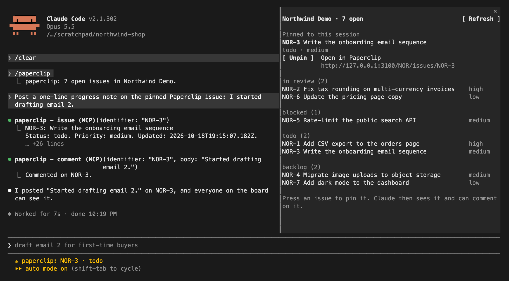

# Paperclip for Claude Code

A Claude Code mod for [Paperclip](https://github.com/paperclipai/paperclip). Pin a Paperclip issue to your Claude Code session, see the board in a side pane, and let Claude read the issue and post progress comments on it.



The screenshot is a real Claude Code session against a local Paperclip server with a demo company.

## What it does

- **`/paperclip`** opens a pane with the open issues of your company, grouped by status (in progress, in review, blocked, todo, backlog). Press an issue to pin it.
- **`/paperclip NOR-3`** pins an issue to the session. Claude gets the issue's description and latest comments right away.
- **Pinned issue in the prompt.** While an issue is pinned, Claude's system prompt carries one short section naming it, so Claude knows what it is working on. The pin is kept per folder and survives `/clear` and restarts.
- **Tools Claude can call:**
  - `mcp__paperclip__issues` lists open issues.
  - `mcp__paperclip__issue` reads one issue (the pinned one by default) with its latest comments.
  - `mcp__paperclip__comment` posts a comment on an issue (the pinned one by default).
- **`/paperclip comment <text>`** and **`/paperclip status <status>`** let you comment or move the pinned issue yourself. `/paperclip unpin` and `/paperclip refresh` do what they say.
- **Status line** shows the pinned issue and its status, or the company's open-issue count.

## Install

At the prompt of a Claude Code terminal session:

```
/plugin install paperclip --marketplace eimkasp/paperclip-claude-code
```

Answer `y` to add the marketplace, then choose a scope.

From a shell:

```bash
claude plugin install paperclip --marketplace eimkasp/paperclip-claude-code
```

In the Claude desktop app, where `/plugin` does not run: click + next to the prompt box, then Plugins, Add marketplace with `eimkasp/paperclip-claude-code`, then Add plugin.

Requires a Claude Code build with function-hook plugins (mods). Tested on Claude Code 2.1.302.

## Settings

Set these in `/config` (or when installing):

| Setting | Default | What it does |
| --- | --- | --- |
| Paperclip URL | `http://127.0.0.1:3100` | Where your Paperclip server runs. |
| Company | blank | Issue prefix (`AIM`), name or id. Blank picks the only company, or lets you pick one in the pane. |
| API key | blank | Only for authenticated deployments. Sent as a Bearer token. Stored as a secret. |
| Refresh every (seconds) | `60` | How often the board reloads. `0` turns it off. |

## What it can access

- **Network:** only the Paperclip URL you set, through Claude Code's own fetch. It reads companies, issues and comments, posts comments, and changes an issue's status when you run `/paperclip status`.
- **Claude Code storage:** the pinned issue for each folder and the company you picked in the pane.
- **Your conversation:** one system prompt section while an issue is pinned, and the issue text when you pin it.
- **Writes to Paperclip** happen only when you run `/paperclip comment` or `/paperclip status`, or when Claude calls `mcp__paperclip__comment`. Claude Code permission rules apply to it by that name.

It does not run shell commands, read your files, or start Paperclip agents.

## Limits

- Tested against a local Paperclip server (version 2026.831.1) in `local_trusted` mode. The API key path for authenticated deployments is untested.
- Where an organization manages Claude Code, the pinned-issue prompt section and the `/clear` restore do not run unless the organization lists this plugin in managed settings.
- The Claude Code mod API is early access and may change between releases.

## Develop

```bash
claude plugin validate .
claude plugin test .
claude --plugin-dir .
```

## License

MIT
